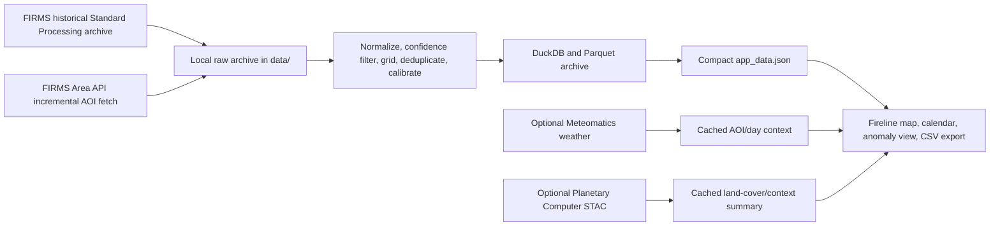

# Fireline Data and Global Offers Plan

## Goal

Use NASA FIRMS as the authoritative source for active-fire detections and keep the existing harmonized MODIS/VIIRS calendar as the core of the system. Add other data and Global Offers only where they improve a specific user task: understanding fire weather, adding map context, collaborating on the build, or publishing the app.

## Current system

- `pipeline/harmonize.py` ingests local FIRMS CSV/Parquet files, optionally fetches FIRMS Area API data, and writes DuckDB, CSV/Parquet, and `app_data.json`.
- `src/main.jsx` loads the generated JSON into the map, AOI controls, calendar, summaries, anomaly view, and CSV export.
- The app already has a synthetic preview when no real FIRMS archive is present.
- `FIRMS_MAP_KEY` is the only credential currently wired into the code. There are no source archives in `data/` in the current project state, so real calibration and coverage remain unverified.

## Recommended use of data and offers

| Priority | Resource / offer | Use in Fireline | Credential or spend |
|---|---|---|---|
| 1 | NASA FIRMS Standard Processing (MODIS and VIIRS) | Historical archive for the full calendar and 2012–2023 sensor-overlap calculation. Download regional files for the study AOI, then retain the raw files in `data/` with source and date in filenames. | Free NASA FIRMS MAP_KEY for FIRMS web services; historical bulk files can also be downloaded from FIRMS. |
| 1 | NASA FIRMS Area API | Incremental recent observations for a selected AOI. Store each dated response in a local raw-data subfolder, then rerun the same harmonization pipeline; do not call the API from every visitor’s browser. | `FIRMS_MAP_KEY`, kept in a local `.env`. |
| 2 | Meteomatics Weather API | Optional fire-weather context for a user-selected AOI/date: show daily temperature, wind, precipitation, and relative humidity alongside hotspot anomalies. Sample a small set of representative points or a coarse grid, cache by location/date, and make clear this is weather context rather than a fire-danger forecast. | Offer credentials from the provider; not needed for the FIRMS calendar. Its stated offer limit is 1,000 queries/day, so avoid one query per hotspot or map movement. |
| 2 | Microsoft Planetary Computer | Optional land-cover/ecoregion context for explaining where anomalies occur. Use the public STAC API to find an appropriate catalog collection and fetch only assets intersecting the AOI; add a land-cover breakdown only after validating collection coverage and license/attribution. | Public STAC discovery needs no account. Some underlying assets require a short-lived data access token; no standing API key is expected for basic discovery. |
| 3 | Azure **or** Google Cloud | Host a small API/static site or scheduled ingestion only if local/demo hosting becomes a bottleneck. Pick one provider. Keep historical harmonization as a batch job and publish compact app JSON rather than doing heavy geospatial work on each page request. | Free credits are temporary and may require payment-card verification; set budget alerts and shut down unused services. |
| 3 | GoDaddy Registry / Porkbun domain offer | Give the finished demo a stable, memorable public URL after the app is ready to publish. | Optional; confirm renewal price and turn off paid add-ons/renewal if not wanted. |
| Team workflow | Miro templates, Teams Free | Use the Miro hackathon board for task ownership and user-flow decisions; use Teams for coordination if the team already works there. | Optional; Miro Business trial has a 14-day end date, so prefer the free template/education offer unless the team needs Business features. |
| Developer workflow | GitHub Copilot Free, Microsoft Copilot | Optional coding/research assistance for the team. These are development tools, not runtime dependencies and should not receive secrets or private user data. | Optional; no project API key. |

## Data flow

The FIRMS record remains the only input to the harmonized hotspot count and HFAI. Weather and land-cover fields are separate contextual layers and must not change FIRMS observations or the calibration.

## Efficient rollout

### Phase 1 — establish real fire data

1. Obtain a free FIRMS MAP_KEY and place it in `D:\harmonization_nasa\.env` as `FIRMS_MAP_KEY=...`; do not paste the secret into chat, source code, screenshots, or committed files.
2. Select a manageable first AOI (for example, the intended pilot region) and download Standard Processing MODIS and VIIRS archives covering the desired calendar. Use the same geographic bounds and dates for both sensors. Keep original downloads unchanged in `data/raw/` and record source, download date, and coverage in a small manifest.
3. Use Area API only for recent incremental updates on that AOI. Check availability before requesting dates and save raw responses to disk so a rerun does not consume another request.
4. Before enabling fetches, adjust the pipeline’s `--day-range` validation to the currently documented FIRMS maximum of five days. Add bounded retries and friendly handling for empty/error responses. Split large date spans into small requests and avoid global VIIRS daily pulls.
5. Rebuild the archive and confirm date coverage, counts by sensor/year, missing dates, confidence filtering, and the number of overlap co-observations. Treat current scaling factors as provisional until checked against actual archives.

### Phase 2 — improve decision context

1. Add a user-controlled “Weather context” layer backed by Meteomatics only after Phase 1 works. Query only when the user requests context or changes AOI/date, at a coarse spatial sampling (not every hotspot), then cache results. Display source, valid time, units, and missing-data status.
2. Explore Planetary Computer collections for land cover or ecoregions and use STAC search with the selected AOI. Start with a one-time/batch summary by grid cell or region; avoid downloading imagery to the browser. Keep collection attribution and coverage metadata visible.
3. If weather or context is unavailable, the core calendar must still load and export normally.

### Phase 3 — publish only when needed

1. Build the app as a static frontend with precomputed `app_data.json`; serve larger archives from an API only if data size or update cadence requires it.
2. Choose either Azure or Google Cloud, use one service for the demo, set budget alerts, and store credentials in that platform’s secret manager. Do not put provider credentials in `src/` or `public/`.
3. Claim a domain only after choosing a host. Check trial/renewal dates for any offer that requests billing information.

## Secrets and inputs needed next

For the first implementation step, only provide/configure:

- `FIRMS_MAP_KEY` — needed for the optional Area API pull. Add it to the local `.env` file yourself; the project already ignores `.env` in Git.
- A pilot AOI as west,south,east,north coordinates (or the country/region to use).
- Historical period and preferred sensor products. Recommended default: MODIS + VIIRS Standard Processing for the historical archive, followed by recent Standard Processing or NRT updates for the pilot AOI.

Do not obtain Azure, Google Cloud, Meteomatics, or Planetary Computer credentials yet. The first two are deployment choices, Meteomatics is an optional add-on, and Planetary Computer’s public STAC search can be evaluated without an account. If weather integration is approved after the FIRMS archive is stable, obtain the Meteomatics offer credentials then and put them in local environment variables rather than chat.

## Operational safeguards

- Keep raw downloads immutable and reproducible; record source ID, AOI, requested dates, retrieval date, and processing version.
- Do not query the whole world for every update. Query a selected AOI, fetch only missing dates, and cache successful responses.
- Do not expose API keys in browser code, generated JSON, CSV exports, logs, or Git.
- Label NRT data and Standard Processing data distinctly because their latency and processing maturity differ.
- Preserve the demo banner until real FIRMS observations are loaded. Never describe synthetic points as NASA detections.
- Show data coverage and sensor provenance with the calendar. A missing detection is not proof that no fire occurred.
- Keep weather and land-cover context separate from the HFAI calculation; do not call the result a forecast or operational alert.

## Submission compliance gate

Treat the pasted final submission requirements as release criteria for all implementation, documentation, and demo work. The page itself warns that participant/Local Lead content may not have been reviewed by NASA, so use the official 2026 project form and Participant Terms and Conditions as the final authority if wording differs. The current 2026 site lists project submission closing on November 15, 2026 at 11:59 PM in the registered event's local time; confirm the team's own event page for its applicable deadline.

### Product and public access

- Keep the project tied to the official “Harmonization of MODIS and VIIRS Hot Spots” challenge and visibly show how FIRMS data powers the harmonized calendar. Preserve provenance and avoid presenting synthetic preview data as NASA observations.
- Publish a working project link that opens without a password, permission grant, or registration. The project/demo links must be full URLs. A public repository can complement the live app but does not substitute for a usable project link where a live app is available.
- Prepare one public demo: either a slide deck of no more than seven slides total (including title/introduction) or a video no longer than 30 seconds. Host it on a public platform and check the link in a signed-out/private browser session.
- Complete the submission fields: project name; 50–200 word suggested summary (within the form's character limit); project demonstration link; project link; project details (function, benefits/impact, tools/languages, creative choices and factors considered); NASA data/resource links; other Space Agency Partner/third-party data, code, text, images, and tools; SI-use selections; terms acceptance; and original-work/resource-list confirmation.
- Use the submitted project name consistently. The current form text says “Project Absolute Zero Chill”; the app's product name is “Fireline”. Explain their relationship consistently in the summary and project details, or align the form name with the final team choice.

### Sources, licenses, and originality

- Maintain a release resource inventory with the full public URL and name for every NASA resource and every external data, code/library, text, font, map style/tile, image, audio, and video source used. Include open-source and freely available material. Check that non-NASA materials may be publicly used and identify applicable licenses in project documentation.
- Keep the NASA FIRMS resource in the NASA Data field. Put implementation libraries, optional Meteomatics/Planetary Computer data, map assets, and other external materials in the “Space Agency Partner & Other Data” field as applicable. Do not claim unused optional offers as data sources.
- Ensure all submitted creative/code/data work is original or properly licensed and attributed. Do not include generated NASA logos, flags, mission identifiers, or other NASA branding/design elements.

### Super Intelligence disclosure

- Since SI tools are being used to help plan and develop this project, select the applicable SI-use options in the submission form; do not select “I did not use SI.”
- Add a clear disclosure in the project details or a public project “About / Credits” section describing where SI assisted (for example, planning, code, documentation, or generated media, as applicable). Add descriptive metadata/credits for SI-assisted code and data artifacts where included.
- If any project image or video is SI-generated, place a visible SI-generated watermark on that asset. If audio is SI-generated, disclose that in its descriptive text and metadata. Do not use SI-generated media without the required labels.
- Keep the SI disclosure factual: identify the kinds of assistance actually used and retain team review/ownership of the submitted work.

### Final release check

Before submission, verify that (1) the public app and demo links work without signing in, (2) the demo meets its slide/time limit, (3) NASA data is visibly integrated and cited, (4) all external resources and licenses are listed, (5) SI disclosures/watermarks are present where required, (6) the summary and details fields are complete and consistent, and (7) the registered team members and required confirmations are complete in the submission form.

## References

- [NASA FIRMS Area API](https://firms.modaps.eosdis.nasa.gov/api/area) — request syntax, supported products, date range, and MAP_KEY limits.
- [NASA FIRMS API usage tutorial](https://firms.modaps.eosdis.nasa.gov/content/academy/data_api/firms_api_use.html) — availability endpoint, archive dates, transaction behavior, and response fields.
- [Microsoft Planetary Computer documentation](https://planetarycomputer.microsoft.com/docs/) — public STAC discovery and data access patterns.
- [Planetary Computer token documentation](https://planetarycomputer.microsoft.com/docs/concepts/sas/) — when SAS tokens are needed for individual data assets.
- [NASA Space Apps 2026](https://www.spaceappschallenge.org/2026/) — current event submission timeline.
- [NASA Space Apps Participant Terms and Conditions](https://www.spaceappschallenge.org/legal/) — official participation terms.

