# Fireline Technical Manual

## Purpose and data status

Fireline is a local demonstration of a harmonized MODIS/VIIRS active-fire calendar for the 2026 NASA Space Apps challenge. It standardizes NASA FIRMS hotspot records, deduplicates repeated observations on a shared daily grid, estimates an overlap-period scaling, and serves the resulting activity through a Vite + React + MapLibre interface.

This workspace currently contains no raw satellite CSV archives in `data/`. The app's visible **DEMO PREVIEW** points are synthetic and must not be cited as observations. With no CSVs, the pipeline creates valid empty archive tables. Calibration metrics and schema compatibility should be checked against the supplied bulk files.

## Architecture

```mermaid
flowchart LR
  A[Global FIRMS bulk CSV files on disk] --> B[DuckDB out-of-core CSV scan]
  B --> C[SQL schema normalization + confidence filter]
  C --> D[0.05 degree grid + UTC day]
  D --> E[2012-2023 overlap fit]
  E --> F[Cell-day deduplication + HFAI]
  F --> G[DuckDB, CSV, Parquet, app_data.json]
  G --> H[Vite + React]
  H --> I[MapLibre AOI + activity calendar]
  I --> J[Browser-filtered CSV export]
```



## Data ingestion

The pipeline scans `data/` recursively for bulk `.csv` files. DuckDB's `read_csv_auto` scans files directly from disk with `union_by_name=true`; normalization, confidence filtering, overlap summaries, and cell-day aggregation are SQL relations in DuckDB. The source archive is never collected into a Python list. DuckDB working memory is capped at 4 GB by default and oversized operations can spill to `output/duckdb_tmp`; override the cap with `--memory-limit` (for example, `--memory-limit 2GB`). The final browser JSON is streamed in batches of 5,000 rows. This supports global bulk archives without source-row-sized Python memory use; reserve adequate disk space for the database, spill files, and exported artifacts.

Sensor identity comes from the filename and satellite field. MODIS/Terra/Aqua identify MODIS. `VIIRS_SNPP`, `VIIRS_NOAA20`, and `VIIRS_NOAA21` all map to `sensor='VIIRS'`, while the separate `satellite` column records `Suomi-NPP`, `NOAA-20`, or `NOAA-21`. Prefer clear names such as `MODIS_SP_2012.csv`, `VIIRS_SNPP_2020.csv`, `VIIRS_NOAA20_2022.csv`, and `VIIRS_NOAA21_2025.csv`. If the archive has no recognizable VIIRS platform in either its name or `satellite` field, provenance falls back to the source value/name and should be reviewed.

Input columns are case-insensitive. The reader recognizes:

| Canonical field | FIRMS aliases |
|---|---|
| latitude, longitude | `latitude`/`lat`, `longitude`/`lon` |
| date, time | `acq_date`/`date`/ISO `datetime`, `acq_time`/`time` |
| confidence | `confidence`/`conf` |
| FRP | `frp` |
| MODIS thermal brightness | `brightness`, `bright_t21`, `bright_t31` |
| VIIRS thermal brightness | `bright_ti4`, `bright_ti5` |
| footprint/metadata | `scan`, `track`, `satellite` |

MODIS confidence is numeric and normalized as low (<50), nominal (50–79), or high (>=80); low and unknown confidence are filtered. VIIRS confidence is categorical (`l`, `n`, `h`); low is filtered, and unknown categories are retained but labeled unknown. This matches the documented FIRMS conventions but should be checked against each local archive's headers and provenance before operational use.

There is no FIRMS Area API request path in this pipeline. Download global bulk archives separately and place the CSVs in `data/`; `FIRMS_MAP_KEY` is not used by ingestion.

### Platform transition

Suomi-NPP VIIRS observations are distinguished from NOAA-20 and NOAA-21 in `satellite`, while all three contribute to the shared VIIRS category used for deduplication and overlap calibration. The VIIRS archive therefore continues across the S-NPP retirement date (Nov 2, 2026) as NOAA-20/21 observations become the active platforms. Calibration is estimated from the actual MODIS/VIIRS overlap rows supplied (2012–2023 by default); no platform continuity or calibration should be assumed for dates missing from the local archive.

## Harmonization method

### Spatial grid and UTC cell-days

Coordinates are assigned to approximate 0.05-degree cells. Latitude index is

\[
i_\phi=\left\lfloor\frac{\phi+90}{0.05}\right\rfloor
\]

and longitude cell width grows with latitude as `max(0.01, 0.05 / max(0.2, cos(latitude)))`; this keeps cell area approximately comparable outside the tropics. This is an approximate grid, not an authoritative equal-area projection. Each detection is bucketed by its UTC acquisition date. There is no temporal tolerance across dates.

### Overpass deduplication

For each `(cell_id, acq_date)`, all sensor and satellite observations are grouped. One row is retained: the row with maximum FRP, with high confidence as a tie-breaker. The output's `hotspot_count` is 1 for that unique active cell-day; `source_count` and `sensors_seen` preserve evidence of repeats. This reduces multi-satellite overpass multiplication, but it does not identify separate simultaneous fires inside one grid cell.

### 2012–2023 overlap scaling

Only dates in the inclusive 2012-01-01 through 2023-12-31 window are considered. A co-observed date has at least one accepted MODIS and one accepted VIIRS record. On those dates:

\[
r_{cell}=\operatorname{clip}_{[0.25,4]}\left(\frac{N_{MODIS\ cell-days}}{N_{VIIRS\ cell-days}}\right)
\]

where totals cover co-observed dates. For FRP, only cell-days present in both sensors are paired, and

\[
r_{FRP}=\operatorname{clip}_{[0.25,4]}\left(\operatorname{median}\left(\frac{FRP_{MODIS}}{FRP_{VIIRS}}\right)\right).
\]

MODIS scales are fixed to 1. VIIRS deduplicated events are assigned `HFAI = r_cell` and calibrated FRP is `FRP × r_FRP`; `calibrated_hotspot_count` also contains `r_cell`. If the input has no co-observed dates, both VIIRS scales default to 1 and the report shows zero co-observations. The scale factors are relative to the supplied archive and chosen grid/filter, not a peer-reviewed global sensor calibration. They must be reported with coverage counts and independently evaluated before drawing scientific conclusions.

### Calendar baselines and anomalies

The pipeline groups unique cell-days by calendar month and year. For each year-month, the reference population consists of the other available years for that month. It reports median HFAI, empirical 25th and 75th percentiles, percent departure, and z-score using the population standard deviation:

\[
\%\Delta=100\frac{x-\tilde{x}}{\tilde{x}},\qquad z=\frac{x-\tilde{x}}{\sigma}.
\]

The app recomputes the historical median within the selected map bounds. A zero median has no defined percent departure; the pipeline emits `null`. Anomaly comparisons are conditional on input coverage and do not imply a fire-weather forecast.

## Install and run

Windows PowerShell from the repository root:

```powershell
python -m venv .venv
.\.venv\Scripts\Activate.ps1
python -m pip install duckdb
npm install
```

The checked-in `package-lock.json` pins the frontend package tree. `npm install` supplies Vite, React, MapLibre GL JS, ECharts, and the test tooling. ECharts is included for future extensions; the present calendar is a semantic React heatmap.

Put FIRMS archives in `data/`, then run:

```powershell
python pipeline\harmonize.py
```

The run writes DuckDB and CSV/Parquet artifacts under `output/` and refreshes `public/app_data.json`. The app automatically uses the real archive when that file has hotspots; with no data it keeps the labeled synthetic preview.

## Optional Global Offers configuration

Copy `.env.example` to `.env` and enter provider credentials only when using those services. `VITE_MAPBOX_ACCESS_TOKEN` is an origin-restricted **public** token used for an optional Mapbox style in the MapLibre renderer. Leave it blank to use the built-in MapLibre background and land outline. Vite exposes `VITE_*` values in browser code, so never put private credentials there. `WEATHER_API_KEY` is reserved for a future server-side weather integration and is not read in this browser-only app. `FIRMS_MAP_KEY` is likewise not used by the bulk CSV pipeline. Restart the Vite dev server after editing `.env`.

Run locally and build:

```powershell
npm run dev
npm run build
```

Vite prints the local URL, normally `http://localhost:5173/`.

## Emergency manager user guide

1. **Select an area.** The map opens at global bounds (-180, -90, 180, 90). Drag across the map to draw a rectangular AOI, or enter west, south, east, and north longitude/latitude bounds and press **Apply bounds**. The map shows the AOI outline and detections inside it. Click a hotspot to see its sensor, platform, and date.
2. **Choose dates.** Set the inclusive start and end date. The calendar and summary respond to the selected time window and AOI.
3. **Read seasonal patterns.** Each calendar row is a year; columns are months. Cells encode cell-day activity (or HFAI when that metric is selected). Blank cells have no records in the archive for that area/month.
4. **Compare anomalies.** Turn on **Compare anomaly** to compare each year-month with the same calendar month's median across available years in the selected AOI. Blue indicates below median, pale center indicates near median, and red indicates above median on the RdYlBu legend. The intensity view uses a YlOrRd ramp. Every calendar cell has a text label for assistive technology and a value tooltip.
5. **Export.** Press **Download harmonized CSV**. The file contains filtered cell-day records with sensor, satellite, acquisition date/time, coordinates, FRP, calibrated FRP, confidence, count, and HFAI fields. The active AOI and date range are applied before download.

## Outputs and tables

- `observations`: accepted, normalized source observations.
- `harmonized_daily`: one strongest observation per unique grid cell and UTC date, plus calibrated activity and repeat-source metadata.
- `harmonized_hotspots.csv` and `harmonized_hotspots.parquet`: portable deduplicated row-level archive.
- `app_data.json`: run metadata, overlap calibration metrics, monthly baselines, and map records, including platform provenance in `satellite`.

## Limitations and interpretation

- No raw satellite data was supplied in the workspace at build time. The exact local schemas and real overlap metrics remain unverified.
- The map's generalized continent silhouettes are an orientation aid; there is no external tile service or administrative boundary layer.
- Grid dimensions are approximate, FRP is sensor-dependent, and cell-day counts are not burned area, fire perimeter, or unique incident counts.
- Missing observations, cloud/smoke effects, scan geometry, confidence policy, spatial resolution, and changing coverage affect comparisons. The baseline is only as complete as `data/`.
- The app is an analysis aid, not an operational alert service. Verify important decisions with NASA FIRMS and local authorities.
